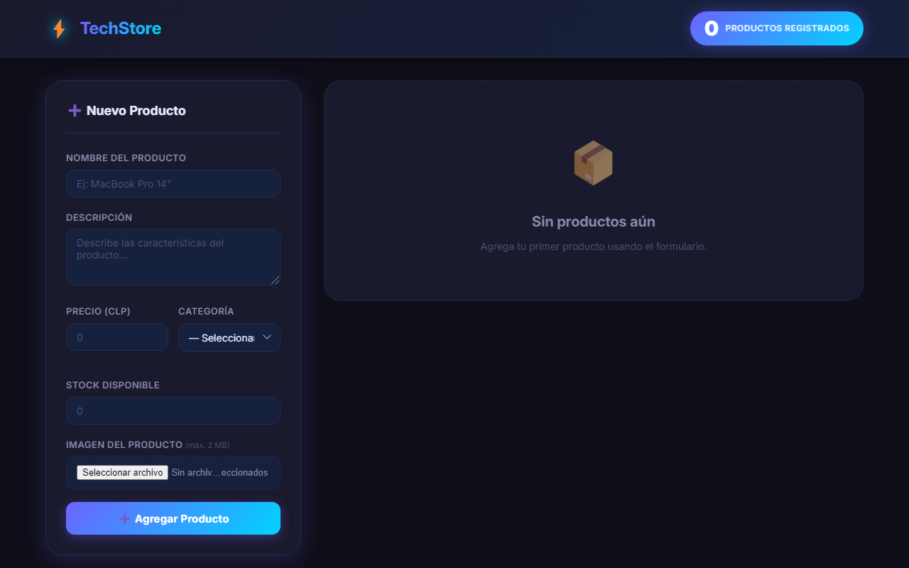

# ⚡ TechStore — Gestión de Productos

[](https://github.com/Fernandamv96/tienda-tech/actions/workflows/ci.yml)


Aplicación **CRUD completa** para gestión de productos tecnológicos, desarrollada en ReactJS con diseño oscuro moderno y 100% responsive.

🔗 **Demo en vivo:** <https://tienda-tech-olive.vercel.app>



---

## ✨ Funcionalidades

- ➕ Agregar productos con formulario validado
- ✏️ Editar cualquier producto con un clic
- 🗑️ Eliminar con mensaje de confirmación
- 🔢 Contador dinámico que se actualiza en tiempo real
- 📷 Carga de imagen con vista previa y validación máx. 2 MB
- 📦 Control de stock con indicador visual (verde / amarillo / rojo)
- ✅ Validaciones en todos los campos antes de guardar
- 📱 Diseño responsive para móvil, tablet y escritorio

---

## 🛠️ Tecnologías

- **ReactJS** — Componentes funcionales
- **useState** — Manejo de estado
- **Formularios controlados** — Inputs sincronizados con el estado
- **CSS3** — Grid, Flexbox, variables CSS, dark theme, animaciones
- **JavaScript ES6+** — Validaciones, FileReader API
- **Vercel** — Deploy automático desde GitHub

---

## 📁 Estructura
tienda-tech/
├── public/
│   └── index.html
├── src/
│   ├── App.js       # Lógica CRUD + componentes
│   ├── App.css      # Estilos dark theme
│   ├── index.js     # Entrada React
│   └── index.css    # Reset CSS
└── package.json

## 🎯 ¿Qué problema resuelve?

Practica el ciclo CRUD completo en React (crear, listar, editar y eliminar productos) con estado local y validaciones, como base para conectar después una API real.

## 🚀 Ejecutar localmente

```bash
git clone https://github.com/Fernandamv96/tienda-tech.git
cd tienda-tech
npm ci
npm start                      # http://localhost:3000
CI=true npm run build          # build + ESLint estricto
```

---

## 🔒 Calidad y seguridad

- CI en cada push y PR (tests de react-scripts + build con ESLint estricto), además de CodeQL, Dependabot y gitleaks en pre-commit.
- Para reportar vulnerabilidades, mira [SECURITY.md](SECURITY.md).

## 💡 Qué aprendí

- A manejar estado de formularios y listas con `useState`, y a validar antes de guardar.
- A organizar un CRUD en componentes reutilizables.
- A desplegar una app de Create React App en Vercel.

## 📄 Licencia

[MIT](LICENSE) © 2026 Fernanda (Fernandamv96)

## 👩‍💻 Autora

**Fernanda** · [@Fernandamv96](https://github.com/Fernandamv96)
